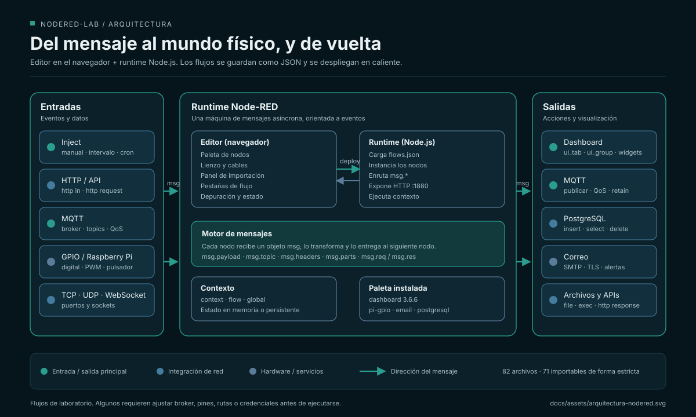
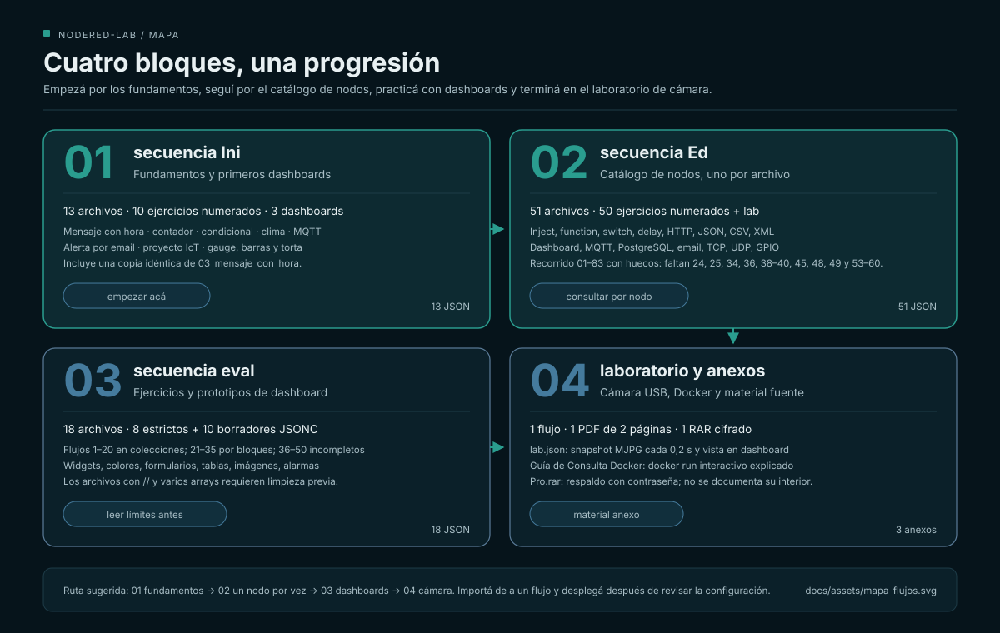
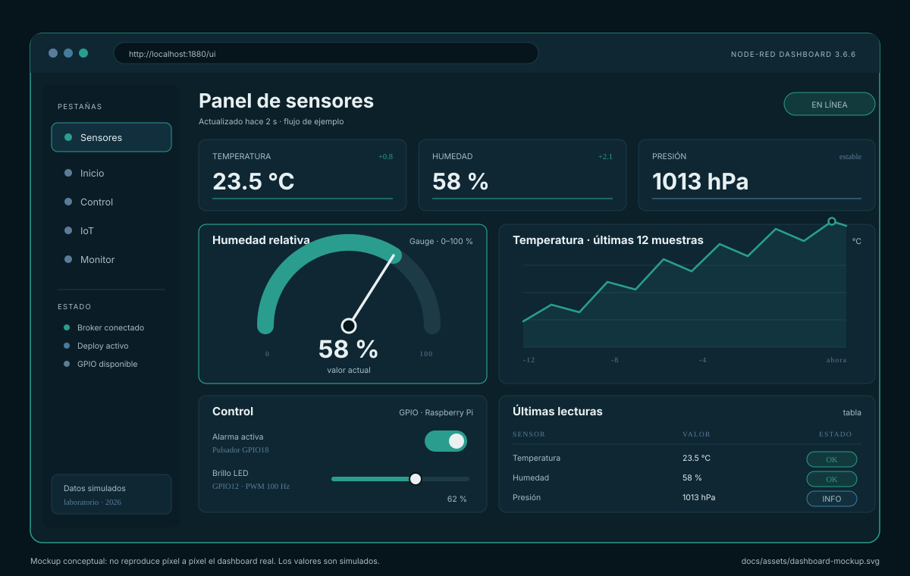

<div align="center">

# Node-RED Lab

### Flujos, dashboards, MQTT y GPIO para aprender haciendo

[](https://nodered.org/)
[](https://flows.nodered.org/node/node-red-dashboard)
[](LICENSE)
[](#límites-y-estado-real)

**82 archivos JSON · 322 nodos · 62 tipos de nodo · 18 pestañas de dashboard**

[Mapa de flujos](docs/assets/mapa-flujos.svg) · [Arquitectura](docs/assets/arquitectura-nodered.svg) · [Mockup de dashboard](docs/assets/dashboard-mockup.svg) · [Datasheet](docs/datasheet.md) · [Desarrolladores](docs/developer.md) · [Referencias](docs/REFERENCES.md)

</div>

---

> **Aviso de alcance.** Este repositorio es una **colección de flujos de laboratorio**, no una aplicación Node-RED lista para producción. Varios flujos usan brokers públicos, credenciales de ejemplo, rutas locales, pines de Raspberry Pi y datos simulados. Antes de ejecutarlos, revisá [Límites y estado real](#límites-y-estado-real) y ajustá broker, pines, rutas y credenciales.

---

## Índice

- [Qué es Node-RED](#qué-es-node-red)
- [Qué es este repositorio](#qué-es-este-repositorio)
- [Principio de funcionamiento](#principio-de-funcionamiento)
- [Mapa de flujos](#mapa-de-flujos)
- [Requisitos](#requisitos)
- [Instalación](#instalación)
- [Cómo importar un flujo](#cómo-importar-un-flujo)
- [Primer flujo en cinco minutos](#primer-flujo-en-cinco-minutos)
- [MQTT](#mqtt)
- [Dashboard](#dashboard)
- [GPIO de Raspberry Pi](#gpio-de-raspberry-pi)
- [PostgreSQL, correo y archivos](#postgresql-correo-y-archivos)
- [HTTP, APIs y cámara USB](#http-apis-y-cámara-usb)
- [Ejemplos de uso realistas](#ejemplos-de-uso-realistas)
- [Diagrama de conexión](#diagrama-de-conexión)
- [Calibración](#calibración)
- [Seguridad y buenas prácticas](#seguridad-y-buenas-prácticas)
- [Límites y estado real](#límites-y-estado-real)
- [Solución de problemas](#solución-de-problemas)
- [Estructura del repositorio](#estructura-del-repositorio)
- [Documentación y licencia](#documentación-y-licencia)

---

## Qué es Node-RED

Node-RED es una herramienta de programación visual y de bajo código para aplicaciones orientadas a eventos. Nació en IBM en 2013 (Nick O'Leary y Dave Conway-Jones) y hoy es un proyecto de la OpenJS Foundation. Corre sobre **Node.js**, se edita en el navegador y guarda los flujos como **JSON**.

La idea es conectar **nodos** con cables. Cada nodo recibe un objeto `msg`, lo transforma y lo entrega al siguiente. El runtime se encarga del orden, de las llamadas asíncronas, de la red y del estado.

```
[ inject ] ──msg──> [ function ] ──msg──> [ debug ]
   dispara            transforma            muestra
```

No es un lenguaje ni un sistema operativo: es un **orquestador de mensajes**. Sirve para pegar servicios, protocolos y dispositivos que de otro modo requerirían scripts separados. La lógica compleja va en un nodo `function` (JavaScript); la simple se resuelve con nodos de configuración.

El **editor** (navegador) sirve para arrastrar, cablear, configurar y desplegar; el **runtime** (Node.js) carga los flujos, instancia los nodos y expone HTTP/WebSocket; el **flujo** es un array JSON; el **mensaje** es el objeto `msg` que viaja de nodo en nodo.

Las propiedades más usadas son `msg.payload` (dato principal), `msg.topic` (tema MQTT, asunto o consulta), `msg.headers` (HTTP), `msg.req`/`msg.res` (petición/respuesta), `msg.parts` (mensajes partidos) y `msg._msgid` (identificador). Además hay **contexto**: `context` por nodo, `flow` por pestaña y `global` por runtime; los flujos `43` y `44` lo demuestran.

### Por qué se usa en IoT

Habla HTTP, MQTT, TCP, UDP, WebSocket y serial sin escribir servidores; tiene nodos para GPIO, bases de datos, correo y archivos; el dashboard se arma con widgets y se actualiza por WebSocket. Es fácil de prototipar y de enseñar porque el flujo se ve. La contraparte: **un flujo visual también puede ser inseguro, difícil de versionar y frágil si no se documenta**. Ese es el motivo de este README y de `docs/`.

---

## Qué es este repositorio

`nodered-lab` reúne flujos Node-RED usados como material de aprendizaje y laboratorio. Proviene de `jmadasme/NodeRed`, según [`versions/NodeRed/VERSION.md`](versions/NodeRed/VERSION.md). La copia conserva el contenido original y excluye credenciales, bases de datos y artefactos de ejecución.

**No contiene** `package.json`, `node_modules`, `flows.json`, `flows_cred.json`, `settings.js`, credenciales reales ni un servidor listo para desplegar. **Sí contiene** 82 archivos JSON, un PDF de Docker, un RAR cifrado y tres secuencias didácticas.

### Procedencia y cifras

| Dato | Valor |
|---|---|
| Origen declarado | `jmadasme/NodeRed` |
| Carpetas | `secuencia Ini`, `secuencia Ed`, `secuencia eval` |
| Archivos JSON | 82 |
| JSON estrictamente válidos | 71 |
| Requieren limpieza (JSONC) | 10 |
| Error de formato | 1 (`83-rpi-gpio-pwm-output.json`) |
| Nodos en los 71 válidos | 322 |
| Tipos de nodo | 62 |
| Pestañas de dashboard | 18 |
| Nodos de dashboard | 98 |
| Saltos CRLF | 81 de 82 archivos |
| Licencia | MIT (ver [`LICENSE`](LICENSE)) |

> **Sobre `VERSION.md`.** Menciona usar los `.example` cuando existan. En esta copia **no hay archivos `.example`**: los valores de configuración son marcadores dentro de los propios JSON y deben reemplazarse a mano.

---

## Principio de funcionamiento

Node-RED es software, pero este laboratorio toca el mundo físico. Entender ese puente ahorra la mitad del diagnóstico.

**Del mundo físico al mensaje.** Un sensor o pulsador cambia una magnitud (temperatura, humedad, presión, luz, posición). Un circuito la convierte en una señal dentro del rango de la Raspberry Pi (0–3,3 V en GPIO digital). El nodo `rpi-gpio in` lee el pin y publica un `msg.payload`; un `function`, `range` o `switch` normaliza, escala o clasifica; el mensaje se publica por MQTT, se guarda en PostgreSQL, se muestra en el dashboard o dispara un correo.

**Del mensaje al mundo físico.** El dashboard, un `inject`, un mensaje MQTT o una petición HTTP generan un `msg`. `rpi-gpio out` escribe el pin: nivel alto/bajo para un LED o relé, o PWM para regular intensidad. Un transistor, MOSFET, optoacoplador o relé adapta los 3,3 V a la carga real.

**La parte de red.** MQTT viaja sobre TCP/IP; un *broker* recibe publicaciones y las reparte según tópico y QoS. HTTP usa peticiones/respuestas; `http in` crea un endpoint y `http response` lo contesta. WebSocket mantiene una conexión bidireccional que el dashboard usa para actualizar widgets sin recargar. PostgreSQL y SMTP son TCP clásico con autenticación. La cámara USB suele exponer un stream MJPEG por HTTP; el flujo pide un *snapshot* JPEG y lo convierte a `data:` URI.



---

## Mapa de flujos

La colección es una progresión. No es necesario importar todo; de hecho, **conviene importar de a un flujo** para entender qué nodo resuelve qué problema.



### `secuencia Ini` — fundamentos (13 archivos)

| Archivo(s) | Qué enseña | Nodos |
|---|---|---|
| `02`–`05` | Primer dashboard, hora, contador con `context` y condicional. | `inject`, `ui_text`, `function`, `switch`, `debug` |
| `06`–`08` | Open-Meteo, gráfico y MQTT local publicar/recibir. | `http request`, `ui_chart`, `mqtt in/out` |
| `09`–`10` | Alerta por correo y mini proyecto IoT con gauge, historial y umbral. | `e-mail`, `ui_gauge`, `ui_chart`, `switch` |
| `a.json`, `b.json`, `c.json` | Dashboards de temperatura, barras y torta. | `ui_gauge`, `ui_chart`, `ui_slider`, `ui_text` |

`03_mensaje_con_hora - copia.json` es una copia idéntica (mismo MD5) del original. **Ruta sugerida:** `02` → `03` → `04` → `05` → `06` → `07` → `08` → `09` → `10` → `a`/`b`/`c`.

### `secuencia Ed` — catálogo de nodos (51 archivos)

Cada archivo aísla un nodo o una técnica. Los números no son consecutivos: faltan, entre otros, 24, 25, 34, 36, 38–40, 45, 48, 49 y 53–60.

**Bloques:** `01–10` inject/debug/function/change/switch/template/delay/trigger/exec · `11–23` RBE, HTTP, join/split, link, status, catch, JSON, CSV, XML, file · `26–28` range, sort, batch · `29–37` widgets de dashboard · `41–47` WebSocket, UDP, variables, cron, POST · `50–52` flujo completo y TCP · `61–62` MQTT · `71–73` PostgreSQL · `81–83` GPIO · `lab` cámara USB.

### `secuencia eval` — ejercicios y dashboards (18 archivos)

Ocho archivos son JSON estricto: `1-10.json`, `11-20.json`, `1-30.json` (que en realidad contiene 21–30), `1.-dashboard basico.json`, `2.botonsimple.json`, `3 slider.json`, `4.grafico simple..json` y `5 switch interruptor.json`. Los otros diez son borradores JSONC: `6 al 20`, `11 al 20` (tres variantes), `21 al 25`, `21 al 35`, `25 al 35`, `25 al 5w vesion 2`, `31-35` y `36 al 50`. Cubren textos, dropdowns, toasts, formularios, tablas, imágenes, alarmas, motor, sensores, iluminación, clima, RFID, inventario y videovigilancia.

**Qué significa JSONC acá:** el archivo tiene comentarios `//` y, en varios casos, **varios arrays consecutivos** en lugar de un único array. Node-RED espera un array JSON estricto. Son borradores de cuaderno, no exportaciones directas. Ver [Cómo importar](#cómo-importar-un-flujo).

### Anexos

| Archivo | Descripción |
|---|---|
| `Guía de Consulta Docker.pdf` | 2 páginas sobre `docker run -it --name ... bash`. |
| `Pro.rar` | RAR v5 de 4 KB, **cifrado con contraseña**. No se documenta su interior. |
| `VERSION.md` | Nota de procedencia. |

---

## Requisitos

**Software:** Node.js 18/20 LTS y Node-RED 3.x (4.x debería funcionar). Para los widgets, `node-red-dashboard` **3.6.6**; para GPIO, `node-red-node-pi-gpio`; para correo, `node-red-node-email`; para PostgreSQL, `node-red-contrib-postgresql`. Opcionales: Mosquitto 2.x (MQTT local), PostgreSQL 13+ y Docker 20+. Navegador reciente para editor y dashboard.

**Hardware:** PC con Linux, macOS o Windows y 2 GB de RAM recomendados. Para GPIO: Raspberry Pi 3/4/5 con header de 40 pines, dos LEDs, resistencias de 220–330 Ω, un pulsador, 10 kΩ opcional, protoboard y cables. Para cámara: USB compatible con UVC servida por MJPEG-streamer.

**Red:** 1880/TCP (editor y dashboard), 1883/TCP o 8883/TLS (MQTT), 5432/TCP (PostgreSQL), 465/587/TCP (SMTP), 8080/TCP (cámara), 18800/TCP (TCP) y 4000/UDP.

> **No hay `requirements.txt`.** No es una aplicación Python: las dependencias se instalan como **paquetes de la paleta** con `npm` dentro de `~/.node-red`, o se declaran en un `package.json` si convertís la colección en una instancia ejecutable. Tampoco hay `package.json` en esta copia.

---

## Instalación

### Opción A: Node-RED nativo

```bash
node --version
npm --version

sudo npm install -g --unsafe-perm node-red
node-red
```

Abrí `http://localhost:1880`. Si el puerto está ocupado, Node-RED lo indica; se cambia con `--port` o en `settings.js`.

### Opción B: Raspberry Pi

```bash
bash <(curl -sL https://raw.githubusercontent.com/node-red/linux-installers/master/deb/update-nodejs-and-nodered)
sudo systemctl enable --now nodered.service
```

El GPIO requiere que el usuario del servicio tenga permisos sobre `/dev/gpiochip*` o pertenezca al grupo `gpio`.

### Opción C: Docker

```bash
docker run -it -p 1880:1880 -v node_red_data:/data --name nodered nodered/node-red
```

`-it` habilita consola interactiva; `-p` publica el editor; `-v` persiste flujos y credenciales; `--name` fija el nombre.

### Instalar los nodos de la paleta

Con Node-RED detenido o desde **Menu → Manage palette → Install**:

```bash
cd ~/.node-red
npm install node-red-dashboard@3.6.6
npm install node-red-node-pi-gpio
npm install node-red-node-email
npm install node-red-contrib-postgresql
```

Reiniciá con `sudo systemctl restart nodered.service` o volvé a lanzar `node-red`.

> **Versión del dashboard.** `lab.json` declara `node-red-dashboard: 3.6.6` en su `global-config`. Esa es la referencia. No es **Dashboard 2.0** de FlowFuse (`@flowfuse/node-red-dashboard`), que usa otra arquitectura. Estos flujos son de la generación Angular clásica (`ui_template` con `ng-src`).

### Servicios opcionales

```bash
# MQTT local
sudo apt install mosquitto mosquitto-clients
sudo systemctl enable --now mosquitto

# PostgreSQL
sudo apt install postgresql
sudo -u postgres psql
```

Para un laboratorio, Mosquitto puede quedar con `listener 1883` y `allow_anonymous true`; **no lo uses en una red no confiable**. El esquema de PostgreSQL está en [`create.txt`](versions/NodeRed/secuencia%20Ed/create.txt): tabla `sensores` con `id`, `nombre`, `valor` y `fecha`. En `docs/datasheet.md` están los comandos completos de creación de base y usuario.

---

## Cómo importar un flujo

1. Abrí `http://localhost:1880`.
2. Menú **☰ → Import**.
3. Elegí **Clipboard** y pegá el JSON, o **select a file** y elegí el `.json`.
4. Decidí si va a un **flujo nuevo** o al **flujo actual**.
5. Importá.
6. Revisá broker MQTT, base de datos, correo y grupos de dashboard.
7. Pulsá **Deploy**.

### Qué revisar después de importar

- **Nodos desconocidos**: `unknown node type` significa que falta el paquete. Instalalo según [Requisitos](#requisitos).
- **Broker MQTT**: los flujos usan `test.mosquitto.org`, `localhost` o IDs como `your-mqtt-broker`. Si el broker no existe en tu instancia, Node-RED lo marca en rojo.
- **Grupos de dashboard**: varios archivos de `secuencia Ed` usan IDs `some-ui-group` y `some-ui-tab`, definidos en `29-dashboard-button.json` y `33-dashboard-text-output.json`. Si importás `31`, `32`, `35`, `37` o `50` sueltos, el widget puede quedar sin grupo; creá uno y asignalo.
- **Pines GPIO**: 17, 18 y 12 son de Raspberry Pi; en una PC no funcionan.
- **Rutas**: `/tmp/miarchivo.txt` y `/tmp/milog.log` deben existir o ser accesibles.
- **Credenciales**: correo y PostgreSQL traen marcadores; no hay contraseñas reales.

### Importación masiva a `flows.json`

Node-RED guarda los flujos en `~/.node-red/flows.json` (o `/data/flows.json` en Docker). Es un **único array**. Con Node-RED detenido:

```bash
cp ~/.node-red/flows.json ~/.node-red/flows.json.bak
jq -s 'add' archivo1.json archivo2.json archivo3.json > ~/.node-red/flows.json
```

Cuidado: los nodos de configuración con el mismo `id` se pisan. Es mejor importar desde la interfaz y revisar conflictos.

### Limpiar un archivo JSONC

Los 10 borradores de `secuencia eval` no se importan tal cual: hay que quitar las líneas que empiezan con `//`, unir los arrays consecutivos y eliminar caracteres de control. En [`docs/developer.md`](docs/developer.md#7-limpiador-jsonc) está el script completo. Trabajá siempre sobre una copia: **algunos archivos tienen comillas mal escapadas y el limpiador automático no los repara todos**.

### Validar antes de importar

```bash
python3 -m json.tool archivo.json > /dev/null && echo "JSON válido"
```

Si falla, el mensaje indica línea y columna. Recordá que `//` no es JSON válido.

---

## Primer flujo en cinco minutos

1. Importá `versions/NodeRed/secuencia Ini/02_hola_dashboard.json`.
2. Deploy.
3. Abrí `http://localhost:1880/ui`.
4. Pulsá **Enviar Hola**.
5. El widget muestra `Hola Dashboard`.

Para ver el mensaje: arrastrá un `debug`, conectalo a la salida del `inject`, Deploy, abrí la pestaña **Debug** (el insecto) y pulsá el inject. Ves `payload`, `topic` y `_msgid`. Ese ciclo **editar → deploy → observar** es todo Node-RED; el resto son nodos.

---

## MQTT

MQTT es publicación/suscripción sobre TCP. Un **broker** recibe mensajes y los reparte a quienes se suscribieron a un tópico. Es el estándar de facto en IoT por su bajo consumo y tolerancia a redes inestables.

### Brokers que aparecen

| Broker | Dónde | Uso | Advertencia |
|---|---|---|---|
| `test.mosquitto.org:1883` | `61`, `62`, `17` | Pruebas públicas | Sin auth ni TLS; **todo es público**. No envíes datos reales. |
| `localhost:1883` | `08` | Mosquitto local | Requiere instalarlo y arrancarlo. |
| `your-mqtt-broker` | Config ID | Marcador | Crear el broker en la instancia. |

### Tópicos de ejemplo

| Tópico | Flujo | Dirección |
|---|---|---|
| `curso/nodered/test` | `61`, `62` | Publica y suscribe. |
| `profe/salida` | `08` | Publica. |
| `profe/entrada` | `08` | Suscribe. |
| `test` | `17` | Salida de estado. |
| `casa/luz` | `1-30.json` | Ejemplo simulado. |

### Probar con Mosquitto

```bash
mosquitto_sub -h localhost -t 'curso/nodered/test' -v
mosquitto_pub -h localhost -t 'curso/nodered/test' -m '{"temperatura":23.5}'
```

### Probar con Python

```python
import paho.mqtt.client as mqtt

client = mqtt.Client()
client.on_connect = lambda c, u, f, rc: c.subscribe("curso/nodered/test", qos=1)
client.on_message = lambda c, u, m: print(m.topic, m.payload.decode())
client.connect("localhost", 1883, 60)
client.loop_forever()
```

`pip install paho-mqtt` dentro de un entorno virtual.

### QoS y retención

| QoS | Garantía | Cuándo |
|---|---|---|
| 0 | Como máximo una vez | Telemetría frecuente; perder una muestra no importa. |
| 1 | Al menos una vez | Mayoría de casos; puede duplicar. |
| 2 | Exactamente una vez | Comandos críticos; más costoso. |

`retain: true` guarda el último mensaje para que un suscriptor nuevo lo reciba al conectarse. Útil para estados (`luz = ON`), no para eventos.

### Seguridad

En producción usá **TLS** (8883), usuario/contraseña y **ACL** por dispositivo. No publiques coordenadas, credenciales ni datos personales en `test.mosquitto.org`. Un cliente sin TLS envía todo en claro, incluido el password.

---

## Dashboard

El paquete `node-red-dashboard` agrega la interfaz en `http://localhost:1880/ui`. Jerarquía:

```
ui_tab (pestaña)
  └── ui_group (grupo/tarjeta)
        └── widget (texto, gauge, chart, slider, switch, ...)
```

### Widgets usados

| Nodo | Función | Ejemplo |
|---|---|---|
| `ui_text` | Texto estático o dinámico. | `33` |
| `ui_gauge` | Medidor semicircular con mín/máx. | `10_proyecto_iot` |
| `ui_chart` | Línea, barra o torta. | `07`, `b.json`, `c.json` |
| `ui_slider` | Valor continuo. | `31` |
| `ui_switch` | Booleano. | `30` |
| `ui_button` | Acción puntual. | `29` |
| `ui_numeric` | Entrada numérica. | `1-10` |
| `ui_text_input` | Entrada de texto. | `32` |
| `ui_dropdown` | Selección. | `11-20` |
| `ui_list` | Lista. | `11-20` |
| `ui_date_picker` | Fecha. | `11-20` |
| `ui_table` | Tabla de objetos. | `1-30` |
| `ui_form` | Formulario. | `37` |
| `ui_toast` | Notificación. | `11-20` |
| `ui_template` | HTML/Angular. | `lab.json` |

### Payloads que entiende

**Gauge y texto:** número o cadena.

```javascript
msg.payload = 23.5;
return msg;
```

**Chart de una serie:**

```javascript
msg.payload = [{
    series: ["Temperatura"],
    labels: ["12:00", "12:05", "12:10"],
    data: [[23.5, 23.8, 24.1]]
}];
return msg;
```

Para varias series, usá un array de objetos `{ series, data }` (uno por serie) con `data` como array de arrays. **Tabla:** array de objetos; las claves son columnas.

```javascript
msg.payload = [
    { id: 1, nombre: "Ana", edad: 22 },
    { id: 2, nombre: "Luis", edad: 30 }
];
return msg;
```

**Formulario:** un objeto con los campos. **Toast:** texto en `msg.payload`, título en `msg.topic`.

```javascript
msg.payload = "La temperatura superó el umbral";
msg.topic = "Alerta";
return msg;
```

### `ui_template`

`lab.json` usa una plantilla Angular:

```html
<div style="text-align:center;">
  
</div>
```

`ng-src` es de AngularJS (dashboard 3.x); en Dashboard 2.0 el binding es distinto. **Riesgo:** `ui_template` inserta HTML. No pongas datos de usuario sin sanitizar; podés inyectar scripts en el navegador de quien mire el dashboard.

### Layout

Una pestaña por dominio, no una por widget. Un grupo por tarjeta lógica. Los widgets con `width: 0` ocupan el ancho automático. Un chart con muchas muestras consume memoria en el navegador: limitá el historial. El dashboard **no tiene autenticación por defecto**; si lo exponés fuera de `localhost`, poné un proxy con TLS y auth.



---

## GPIO de Raspberry Pi

Los flujos GPIO usan `node-red-node-pi-gpio`. **No funcionan en Windows, macOS ni en una PC x86**: necesitan una Raspberry Pi con header de 40 pines.

### Pinout usado

| Pin físico | BCM | Función | Flujo | Conexión sugerida |
|---:|---:|---|---|---|
| 1 | 3V3 | Referencia | — | Pull-up de 10 kΩ al pulsador (opcional). |
| 6 | GND | Masa | — | Masa común. |
| 9 | GND | Masa | — | Cátodo del LED digital. |
| 11 | **GPIO17** | Salida digital | `81` | GPIO17 → 220–330 Ω → ánodo LED → GND. |
| 12 | **GPIO18** | Entrada digital | `82` | GPIO18 → pulsador → GND; pull-up externo a 3V3 si el nodo está en tri-state. |
| 14 | GND | Masa | — | Masa del pulsador. |
| 30 | GND | Masa | — | Cátodo del LED PWM. |
| 32 | **GPIO12** | Salida PWM | `83` | GPIO12 → 220–330 Ω → ánodo LED → GND. |

> **No confundir numeración.** Los flujos usan **BCM** (17, 18, 12), no el número físico. GPIO17 está en el pin 11; GPIO18 en el 12; GPIO12 en el 32.

### Configuración de los nodos

| Flujo | Nodo | Configuración |
|---|---|---|
| `81` | `rpi-gpio out` | Pin 17, salida digital, nivel inicial 0. |
| `82` | `rpi-gpio in` | Pin 18, `tri` (tri-state), debounce 25 ms. |
| `83` | `rpi-gpio out` | Pin 12, `pwm`, frecuencia 100 Hz. |

En `82`, `tri` significa **sin pull-up/pull-down interno**. Sin resistencia externa, el pin queda flotante y el pulsador puede leer ruido. Conectá 10 kΩ entre GPIO18 y 3V3, y el pulsador entre GPIO18 y GND. Si tu versión del paquete lo permite, cambiá el nodo a `up` para usar el pull-up interno.

### Diagrama de conexión

```
Raspberry Pi 40 pines
┌──────────────────────────────────────────────────────────┐
│ 3V3 (pin 1) ──[10kΩ]──┐                                  │
│                       │                                  │
│ GPIO18 (pin 12) ──────┴──── pulsador ──── GND (pin 14)   │
│                                                          │
│ GPIO17 (pin 11) ──[220Ω]──▶|── LED ── GND (pin 9)        │
│                                                          │
│ GPIO12 (pin 32) ──[220Ω]──▶|── LED ── GND (pin 30)       │
└──────────────────────────────────────────────────────────┘
```

`▶|` representa el LED: ánodo hacia la resistencia, cátodo hacia GND.

### Advertencias eléctricas

- **GPIO es de 3,3 V.** Aplicar 5 V puede dañar la Pi.
- Cada pin entrega pocos miliamperios (del orden de 16 mA, con recomendación práctica de ≤8 mA). **No alimentes motores, bombas, relés ni tiras LED directamente.**
- Para cargas inductivas usá transistor/MOSFET, diodo de rueda libre y, si hace falta, optoacoplador.
- Un LED sin resistencia se quema y puede dañar el GPIO. Usá 220–330 Ω.
- Mantené una masa común entre la Pi y la etapa de potencia.
- No conectes 220 V a la protoboard. Para AC usá un módulo relé adecuado y respetá las normas de seguridad.

### Raspberry Pi 5

La Pi 5 cambió el subsistema GPIO (RP1 + libgpiod). `node-red-node-pi-gpio` es de la generación anterior y puede no funcionar igual. Verificá compatibilidad o buscá una alternativa basada en `libgpiod`; no assumes que 17/18/12 responden sin probar.

### Permisos

Si el nodo devuelve `Permission denied`:

```bash
ps -o user= -C node-red
sudo usermod -aG gpio <usuario>
```

Cerrá sesión y reiniciá el servicio. No ejecutes Node-RED como `root` para "solucionar" permisos: es peor.

---

## PostgreSQL, correo y archivos

### PostgreSQL

Los flujos `71`, `72` y `73` usan el nodo `postgres` de `node-red-contrib-postgresql`. La configuración `postgresdb` trae:

```text
host: 127.0.0.1
port: 5432
database: nombre_db
username: usuario_db
password: password_db
```

Son **marcadores**. El flujo `71` arma la consulta con un template string:

```javascript
msg.topic = `INSERT INTO sensores(nombre, valor)
             VALUES('${msg.payload.nombre}', ${msg.payload.valor});`;
return msg;
```

Eso es **inyección SQL** si `nombre` viene de un usuario o de un mensaje externo. Para producción, usá consultas parametrizadas según la API del nodo y validá los tipos. El flujo es didáctico, no seguro. El flujo `73` borra todo menos los últimos 10 registros:

```sql
DELETE FROM sensores
WHERE id NOT IN (
  SELECT id FROM sensores ORDER BY fecha DESC LIMIT 10
);
```

### Correo

`09_alerta_email.json` usa `e-mail` con `smtp.tu-servidor.com`, puerto 465, `secure` y `tls` en true, y `tu@email.com`. La contraseña **no viaja en el JSON**: Node-RED la guarda aparte (`flows_cred.json`). Abrí el nodo y cargala. Para Gmail/Outlook usá una **contraseña de aplicación**, no la principal. El flujo solo envía si el aleatorio supera 30; cambialo por una condición real.

### Archivos

`22-file-in.json` lee `/tmp/miarchivo.txt`, pero `filename` está vacío en el export: configuralo. `23-file-out.json` escribe `/tmp/milog.log` y agrega salto de línea. El nodo `file` puede sobrescribir o appendear; revisá `overwriteFile` antes de apuntarlo a algo importante. No des permiso de escritura sobre directorios del sistema a un flujo de laboratorio.

---

## HTTP, APIs y cámara USB

`06_api_clima.json` consulta Open-Meteo (`latitude=-33.45&longitude=-70.66&current_weather=true`) y devuelve `current_weather.temperature`, `windspeed`, etc. No requiere API key para uso básico; cambiá las coordenadas por las tuyas. `12` y `47` usan `https://jsonplaceholder.typicode.com`, una API falsa para probar GET y POST.

`13` crea `GET http://localhost:1880/hola` y responde `{"mensaje":"Hola desde mi primera API en Node-RED!","timestamp":"..."}`. `http in` define ruta y método; `http response` cierra la petición; sin él, el cliente queda esperando.

`lab.json` pide un snapshot a `http://<host-de-la-camara>:8080/?action=snapshot` con `ret: bin`, convierte el buffer a Base64 (`data:image/jpeg;base64,...`) y lo muestra con `ui_template`. El `inject` corre cada **0,2 s** (el nombre dice "Cada 1s", pero `repeat` es `0.2`). El export usa una dirección de documentación reservada, no una IP real. A 5 fps el navegador acumula imágenes y la Pi consume CPU; para un dashboard, 1 snapshot cada 1–5 s suele alcanzar. La cámara no tiene autenticación por defecto: aislala en una VLAN o protegela con un proxy.

`Guía de Consulta Docker.pdf` (2 páginas) explica `sudo docker run -it --name random-python-edit random-python-interactive bash`: `sudo` eleva privilegios, `docker run` crea el contenedor, `-it` da consola interactiva, `--name` fija el nombre, `random-python-interactive` es la imagen y `bash` el proceso inicial. Al salir con `exit`, el contenedor se detiene. `Pro.rar` es un RAR v5 de 4 KB **con contraseña**; no hay clave en el repositorio y no corresponde fuerza bruta.

---

## Ejemplos de uso realistas

### 1. Calibrar un sensor de temperatura

Lectura cruda `raw` entre 0 y 1023; dos puntos: `raw=200` → 15 °C, `raw=800` → 35 °C.

```javascript
const raw = msg.payload;
const rawBajo = 200, tempBaja = 15;
const rawAlto = 800, tempAlta = 35;

const pendiente = (tempAlta - tempBaja) / (rawAlto - rawBajo);
const offset = tempBaja - pendiente * rawBajo;

msg.payload = Number((pendiente * raw + offset).toFixed(2));
msg.topic = "temperatura";
return msg;
```

### 2. Filtrar ruido con media móvil exponencial

```javascript
const alpha = 0.2;
const anterior = flow.get("temp_filtrada") ?? msg.payload;
const filtrada = alpha * msg.payload + (1 - alpha) * anterior;

flow.set("temp_filtrada", filtrada);
msg.payload = Number(filtrada.toFixed(2));
return msg;
```

### 3. Escalar 0–1023 a 0–100 con `range`

```text
Entrada: 0 .. 1023
Salida:  0 .. 100
Acción:  escalar y limitar
```

Es lo que propone `26-range.json`. Para un sensor real, cambiá los límites por los de su hoja de datos.

### 4. Publicar telemetría por MQTT

```javascript
msg.topic = "casa/sala/temperatura";
msg.payload = JSON.stringify({
    valor: msg.payload,
    unidad: "C",
    ts: Date.now()
});
msg.qos = 1;
msg.retain = true;
return msg;
```

### 5. Guardar en PostgreSQL con consulta parametrizada

```javascript
msg.topic = "INSERT INTO sensores(nombre, valor) VALUES($1, $2)";
msg.params = [msg.payload.nombre, msg.payload.valor];
return msg;
```

Verificá en la documentación de `node-red-contrib-postgresql` cómo se pasan los parámetros en tu versión; la idea es no interpolar texto.

### 6. Alerta por correo con histéresis

```javascript
const T_ALTA = 30, T_BAJA = 28;
const estado = flow.get("alerta_temp") || false;
const t = msg.payload;

if (!estado && t >= T_ALTA) {
    flow.set("alerta_temp", true);
    msg.payload = `Temperatura alta: ${t} °C`;
    return msg;
}
if (estado && t <= T_BAJA) {
    flow.set("alerta_temp", false);
    msg.payload = `Temperatura normalizada: ${t} °C`;
    return msg;
}
return null;
```

La histéresis evita correos repetidos cuando el valor oscila alrededor del umbral.

### 7. Probar el endpoint y el clima

```bash
curl -s http://localhost:1880/hola | jq .
```

El flujo `06` devuelve `current_weather`; tomá `temperature`, `windspeed` y `winddirection`. El backup de `flows.json` y `flows_cred.json` va fuera del repositorio.

---

## Diagrama de conexión

```
[ Sensores / APIs / MQTT / GPIO / TCP-UDP ]
                    │ msg
                    ▼
[ Node-RED: editor + runtime + contexto ] ──▶ [ Dashboard / MQTT / PostgreSQL / SMTP / archivos ]

Raspberry Pi 40 pines
  3V3 (pin 1) ──[10kΩ]──┐
  GPIO18 (pin 12) ──────┴── pulsador ── GND (pin 14)
  GPIO17 (pin 11) ──[220Ω]──▶|── LED ── GND (pin 9)
  GPIO12 (pin 32) ──[220Ω]──▶|── LED ── GND (pin 30)

Red: navegador ──HTTP/WS──▶ :1880 · MQTT ──▶ :1883 · PostgreSQL ──▶ :5432
     SMTP ──▶ :465 · cámara ──HTTP──▶ :8080 · TCP ──▶ :18800 · UDP ──▶ :4000
```

`▶|` representa el LED: ánodo hacia la resistencia, cátodo hacia GND. No publiques direcciones IP privadas en issues, capturas o documentación; usá `<host-del-broker>` o `localhost`.

---

## Calibración

**Sensor analógico:** medí dos puntos con un instrumento de referencia, calculá `pendiente` y `offset` como en el ejemplo 1, aplicá la función y compará en tres puntos intermedios. Si es no lineal, usá interpolación o un polinomio.

**Filtro:** `alpha` cerca de 1 responde rápido y filtra poco; cerca de 0 suaviza y agrega retardo. Para temperatura, `0,1–0,3`; para un pulsador no filtres, usá debounce.

**PWM y LED:** la percepción del brillo no es lineal; si el LED se ve "todo o nada", aplicá `duty = Math.pow(valor/100, 2.2)*100`. 100 Hz puede parpadear en cámara: probá 500–1000 Hz o PWM por hardware. Un LED RGB necesita una resistencia por canal; no los alimentes en paralelo desde un pin.

**Pulsador:** `debounce: 25` ms es un buen inicio; subí a 50 ms si se dispara dos veces, bajá a 10–15 ms si se siente lento. Con `tri-state`, el pull-up externo es obligatorio.

**Umbrales y hora:** `10` alerta por encima de 28 °C; `50` clasifica humedad en `<30`, `30–70` y `>70`; `09` usa un aleatorio >30. Ajustá los umbrales a tu proceso y documentá el cambio. `toLocaleString()` depende de la zona horaria y del locale del runtime; para una zona fija usá `Intl.DateTimeFormat` con `timeZone`.

---

## Seguridad y buenas prácticas

**Antes de exponer Node-RED:** no publiques el 1880 sin TLS y autenticación; configurá `adminAuth` en `settings.js` (hash con `node-red-admin hash-pw`); protegé el dashboard con `httpNodeAuth: { user: "demo", pass: "<hash>" }`; usá un reverse proxy (Caddy, Nginx, Traefik) con HTTPS; restringí por firewall; revisá `httpNodeCors` y `httpNodeRoot` si montás APIs.

**Nodos peligrosos:** `exec` ejecuta comandos (allowlist, sin entrada externa); `file`/`file in` leen o escriben rutas arbitrarias (rutas permitidas, permisos mínimos); `http request` puede ser SSRF (no permitas `file://` ni IPs internas); `postgres` puede sufrir inyección SQL (consultas parametrizadas); `ui_template` puede sufrir XSS (escapá HTML); `e-mail` puede enviar spam (credenciales de aplicación y límites).

**Credenciales:** no están en los JSON; Node-RED las guarda en `flows_cred.json`, cifrado con `credentialSecret`. Si perdés esa clave, no se descifran. No subas `flows_cred.json`, `.env`, claves privadas ni capturas con tokens. En este repositorio solo hay marcadores (`password_db`, `tu@email.com`, `smtp.tu-servidor.com`).

**Broker público y anexos:** `test.mosquitto.org` es de pruebas; cualquiera puede suscribirse. No envíes datos personales, coordenadas, credenciales ni comandos de actuadores reales. `Pro.rar` está cifrado y no se puede auditar; no lo descomprimas sin verificar el origen.

---

## Límites y estado real

Este es el punto más importante para no perder tiempo.

### Cobertura

- **71 de 82** archivos son JSON estricto e importables.
- **10** son JSONC con comentarios y varios arrays; requieren limpieza.
- **1** (`83-rpi-gpio-pwm-output.json`) empieza con una `n` espuria antes del `[`. Si se elimina ese primer byte, el resto es JSON válido. **No se modificó el original**; hacelo sobre una copia.
- Varios archivos están incompletos: no existen los flujos 24, 25, 34, 36, 38–40, 45, 48, 49 y 53–60 en `secuencia Ed`; `36 al 50.json` solo contiene el 36.

### No es una aplicación ejecutable

No hay `package.json`, `flows.json`, `settings.js` ni `node_modules`; no hay tests automatizados, `docker-compose.yml`, migraciones ni seeds. Los flujos se probaron en un entorno de laboratorio, no en producción.

### Valores que hay que cambiar

Reemplazá `test.mosquitto.org` (`61`, `62`, `17`), `localhost:1883` (`08`), `your-mqtt-broker`, `127.0.0.1:5432`/`nombre_db` (`71`–`73`), `smtp.tu-servidor.com`/`tu@email.com` (`09`), la URL de la cámara (`lab.json`), `/tmp/miarchivo.txt` (`22`), `/tmp/milog.log` (`23`) y los pines 17/18/12 (`81`–`83`).

### Limitaciones técnicas

- **Dashboard 3.6.6** es la generación Angular; no es Dashboard 2.0. Las plantillas no son portables sin cambios.
- **GPIO** solo en Raspberry Pi; en Pi 5 puede requerir otra biblioteca.
- **Cámara** a 5 fps puede saturar la Pi y el navegador; bajá la frecuencia.
- **`ui_template`** inserta HTML; no es un lugar seguro para datos de usuario.
- **`exec`** y `file` son nodos de alto privilegio; no los expongas a Internet.
- **JSONC**: algunos archivos tienen caracteres de control y comillas mal escapadas; el limpiador automático no los repara todos.
- **Duplicados**: `03_mensaje_con_hora - copia.json` es idéntico al original (mismo MD5). Se conserva por fidelidad histórica.
- **Etiquetas engañosas**: `1-30.json` contiene 21–30; `lab.json` dice "Cada 1s" pero usa 0,2 s; `83` está roto; `25 al 5w vesion 2` tiene errores de tipeo en el nombre.
- **RAR**: no se puede abrir sin contraseña; no se documenta su contenido.
- **Sin autenticación**: el dashboard y el editor no traen auth configurada.
- **Sin control de versiones de dependencias**: solo `lab.json` declara dashboard 3.6.6; el resto no fija versiones.

### Qué se puede usar con confianza

Los flujos de `secuencia Ed` que son JSON válido, para aprender un nodo. Los dashboards `a`, `b`, `c`, `1-10`, `11-20` y `1-30` como ejemplos visuales. El flujo `50` como patrón de gauge + switch + toast. Los flujos `71`–`73` como punto de partida para PostgreSQL, después de parametrizar. `lab.json` como ejemplo de cámara, después de bajar la frecuencia y asegurar la red.

---

## Solución de problemas

| Síntoma | Causa probable | Solución |
|---|---|---|
| `Cannot find module 'node-red-dashboard'` | Falta el paquete. | `cd ~/.node-red && npm install node-red-dashboard@3.6.6` y reiniciar. |
| `unknown node type` al importar | Falta el paquete del nodo. | Instalar `node-red-node-pi-gpio`, `node-red-node-email` o `node-red-contrib-postgresql`. |
| El import falla con `Unexpected token /` | El archivo es JSONC. | Quitar comentarios `//` y unir los arrays; usar el limpiador. |
| El import falla con `Unexpected token n` | Primer byte espurio en `83`. | Copiar, eliminar la `n` inicial, validar con `python3 -m json.tool`. |
| El widget no aparece o `group not found` | Grupo/pestaña no asignado o definido en otro archivo. | Editar el nodo, elegir grupo; importar `29` y `33`; Deploy; abrir `/ui`. |
| MQTT no conecta o no llegan mensajes | Broker, puerto, TLS, firewall, tópico o QoS. | Probar con `mosquitto_sub`; revisar configuración; probar `#` temporalmente. |
| `Permission denied` en GPIO | Usuario sin permisos. | Agregar al grupo `gpio`; reiniciar sesión/servicio. |
| El pulsador se dispara solo | Pin flotante o rebote. | Pull-up externo; subir debounce; revisar cableado. |
| El LED no enciende | Polaridad, resistencia o pin. | Verificar ánodo/cátodo; probar GPIO17 a 3,3 V con resistencia; medir. |
| PostgreSQL `ECONNREFUSED` | Servicio caído, host/puerto mal, `pg_hba`. | `systemctl status postgresql`; probar `psql`; revisar `pg_hba.conf`. |
| Error de autenticación SMTP | Contraseña normal en vez de app password, puerto/TLS. | Usar app password; probar 465/SSL o 587/STARTTLS. |
| La cámara muestra vacío | URL incorrecta, firewall o snapshot no disponible. | Abrir la URL en el navegador; revisar `mjpg_streamer`; usar `ret: bin`. |
| Node-RED no arranca | Puerto 1880 ocupado o error en `flows.json`. | `ss -ltnp | grep 1880`; restaurar backup; revisar logs. |

---

## Estructura del repositorio

```
nodered-lab/
├── LICENSE · README.md
├── docs/                 datasheet.md · developer.md · REFERENCES.md · BITACORA.md
│   └── assets/           arquitectura-nodered.svg · mapa-flujos.svg · dashboard-mockup.svg
└── versions/NodeRed/
    ├── VERSION.md · Guía de Consulta Docker.pdf · Pro.rar
    ├── secuencia Ini/     13 JSON
    ├── secuencia Ed/      51 JSON + create.txt
    └── secuencia eval/    18 JSON
```

`secuencia Ed/NN-tema.json`: un nodo o técnica por archivo. `secuencia Ini/NN_tema.json`: ejercicios introductorios. `secuencia eval/`: colecciones por rango, con variantes (`version 2`, `version 3`, `vesion 2`). Los nombres con espacios y acentos son parte del material original; no se renombraron.

---

## Documentación y licencia

- [`docs/datasheet.md`](docs/datasheet.md): manual de usuario, especificaciones, catálogo y troubleshooting.
- [`docs/developer.md`](docs/developer.md): arquitectura, formato de flujo, API y extensión.
- [`docs/REFERENCES.md`](docs/REFERENCES.md): enlaces oficiales, paquetes y protocolos.
- [`docs/BITACORA.md`](docs/BITACORA.md): problemas, decisiones y lecciones aprendidas.

El contenido se distribuye bajo **MIT** (ver [`LICENSE`](LICENSE)), con `Copyright (c) 2026 jmadasme`. Node-RED, `node-red-dashboard`, `node-red-node-pi-gpio`, `node-red-node-email`, `node-red-contrib-postgresql`, Mosquitto, PostgreSQL, Open-Meteo y JSONPlaceholder mantienen sus licencias.

Créditos: Nick O'Leary, Dave Conway-Jones y la comunidad OpenJS Foundation; equipo de `node-red-dashboard`; Raspberry Pi Foundation; Open-Meteo y JSONPlaceholder; colección original `jmadasme/NodeRed`.

---

<div align="center">

**Node-RED Lab** · flujos de laboratorio · 2026

Si algo no funciona, empezá por [Límites y estado real](#límites-y-estado-real) y [Solución de problemas](#solución-de-problemas).

</div>
